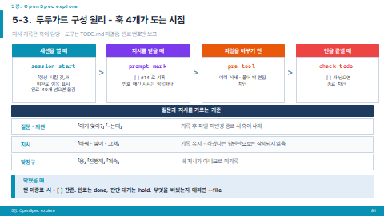

# 투두가드 (todo-guard)

> **베타입니다. 정식 판이 아닙니다.** 아직 버그가 남아 있고, 쓰다 보면 새로 나옵니다.
> 중요한 저장소에 넣기 전에 시험 폴더에서 먼저 써 보십시오. 되돌리는 법은 아래 [걷어내기](#걷어내기)에 있습니다.

Claude Code 가 **시킨 일을 빠뜨리지 않게** 만드는 스킬입니다.

지시가 오는 순간 `TODO.md` 에 번호를 붙여 적고, 끝나지 않은 항목이 남으면 턴 종료를 막습니다.
「하겠습니다」 하고 다른 얘기로 넘어가거나, 다섯 개 중 두 개만 하고 끝내는 일을 막습니다.

```
❯ login.html 에 로그인 폼 넣고 style.css 도 고쳐줘

[todo-guard] #1 등록 → 끝나면 todo.sh done 1
```

일을 안 하고 끝내려 하면 막습니다.

```
[todo-guard] 끝나지 않은 항목 - 끝냈으면 todo.sh done 번호,
             파일을 바꾸지 않는 일이었으면 done 번호 --why "사유", 판단이 필요하면 hold
  - [ ] #1 (11-11 11:15) login.html 에 로그인 폼 넣고 style.css 도 고쳐줘
  이번 지시 #1 에 파일을 하나도 바꾸지 않았습니다. 하겠다고만 하고 끝내지 마십시오
```

안 하고 완료 표시만 하는 것도 막습니다.

```
[todo-guard] #1 는 적힌 뒤 바꾼 파일이 없습니다. 하지 않은 일은 done 하지 않습니다.
  파일을 바꾸지 않는 일이었거나 한 번에 여러 개를 고쳤으면 사유를 붙이십시오: done 1 --why "사유"
```

실제로 고치고 나서야 닫힙니다.

```
[todo-guard] 완료 1개: #1
```

---

## 어떻게 도나

훅 네 개가 각각 다른 시점에 돕니다. 모델이 장부를 직접 쓰지 않습니다 — 훅이 씁니다.



| 훅 | 언제 | 하는 일 |
|---|---|---|
| `session-start.sh` | 세션 열 때 | 남은 항목 · 보류 항목을 알린다 |
| `prompt-mark.sh` | 메시지를 받을 때 | 지시면 `TODO.md` 에 번호를 붙여 적는다 |
| `pre-tool.sh` | 파일을 바꾸기 전 | 무엇을 바꿨는지 기록한다. 프로젝트 밖 편집을 막는다 |
| `check-todo.sh` | 턴을 끝낼 때 | 끝나지 않은 항목이 남으면 종료를 막는다 |

**모델이 `TODO.md` 를 열어 고치지 않습니다.** 도구 호출 한 번이 대화 전체를 다시 읽어 비용이 붙기 때문입니다.
장부 정리는 훅이 하고, 모델은 끝낸 번호만 확인 명령 뒤에 붙입니다.

```
python -m unittest && todo.sh done 14
```

`&&` 라서 **앞 명령이 실패하면 `done` 이 아예 실행되지 않습니다.** 프로젝트에 테스트 · 빌드 · 린트가
있으면 그것이 통과해야 항목이 닫힙니다.

---

## 설치

1. [Releases](../../releases) 에서 `todo-guard.zip` 을 받아 `~/.claude/skills/` 에 풉니다.

   ```
   Windows   C:\Users\<사용자>\.claude\skills\todo-guard\
   macOS     ~/.claude/skills/todo-guard/
   리눅스     ~/.claude/skills/todo-guard/
   ```

   저장소를 바로 받아도 됩니다.

   ```bash
   git clone https://github.com/hull-kr/todo-guard.git
   cp -r todo-guard/todo-guard ~/.claude/skills/
   ```

2. Claude Code 를 다시 열면 스킬 목록에 잡힙니다.

3. 프로젝트 폴더에서 말합니다.

   ```
   투두가드 세팅해줘
   ```

4. **`/exit` 로 나갔다 다시 들어옵니다.** 훅은 세션을 열 때 한 번 읽힙니다.

**스킬은 전역에 한 번만 깔고, 훅은 프로젝트마다 겁니다.** 이 둘은 다른 일입니다.

### 세팅하면 생기는 것

| 파일 | 하는 일 |
|---|---|
| `TODO.md` | 장부. 진행 중 · 완료 · 보류 |
| `.claude/hooks/*.sh` | 훅 껍데기 4개 (스킬 본체를 부르는 한 줄짜리) |
| `.claude/settings.json` | 훅 등록 (있던 설정과 남의 훅은 그대로 둡니다) |
| `CLAUDE.md` | 운영 규칙 대목 병합 |
| `투두가드설명서.md` | 이 프로젝트에서 쓰는 법 |

---

## 쓰는 법

대부분은 **그냥 평소대로 지시하면 됩니다.** 등록 · 완료 · 차단은 훅이 알아서 합니다.
아래는 Claude 가 쓰는 명령이라 사람이 외울 필요는 없습니다.

| 명령 | 하는 일 |
|---|---|
| `todo.sh done 14` | #14 를 완료로. 하위 항목은 끝낸 것만 `done 14.1 14.3` |
| `todo.sh done 14 --file a.tsx` | 항목 글에 파일 이름이 없을 때, 이 항목으로 바꾼 파일을 댄다 |
| `todo.sh done 14 --why "빌드 성공"` | 파일을 바꾸지 않고 끝난 일(빌드 · 테스트 · 조사 · 답변) |
| `todo.sh hold 14 "사유"` | 사용자 판단이 필요해 멈춘다 |
| `todo.sh add "할 일"` | 지시에 없던 일을 스스로 적는다 |
| `rule.sh add "규칙"` | 「앞으로 ~하지 마」를 「항상 지킬 것」에 등록 |
| `doctor.sh <폴더>` | 세팅한 프로젝트를 훑어 상태를 본다. `--fix` 로 손본다 |

사용자가 쓰는 말은 이것뿐입니다.

```
투두가드 세팅해줘
투두가드 걷어내줘
앞으로 커밋 전에 테스트 돌려        ← 「항상 지킬 것」에 등록된다
```

### 완료를 어떻게 검증하나

「했다」는 말만으로 닫히지 않습니다. **파일 변경 기록과 대조합니다.**

| 항목이 어떻게 생겼나 | 무엇으로 검증하나 |
|---|---|
| 글에 파일 이름이 있다 (`login.html 에 폼 넣어줘`) | 그 파일이 **항목이 적힌 뒤** 바뀌었나 |
| 글에 슬라이드 번호가 있다 (`3번 슬라이드 배경`) | 그 번호 파일이 바뀌었나 |
| 아무 단서도 없다 (`구분 안 되는 데 수정해`) | `--file` 로 무엇을 바꿨는지 대게 한다 |
| 파일을 안 바꾸는 일 (`빌드 돌려봐`) | `--why` 로 사유를 요구한다. 사유는 장부에 남는다 |

**못 잡는 것** — 파일은 고쳤는데 **잘못 고친 경우**입니다. 투두가드는 파일이 바뀐 사실만 보고
내용은 보지 않습니다. 그건 프로젝트의 테스트 · 빌드 · 린트가 할 일이고, `&& done` 으로 묶으면 됩니다.

---

## 팀으로 쓸 때

훅과 설정을 저장소에 커밋해 팀이 같이 쓸 수 있습니다.

- 훅 등록에 **PC 경로를 박지 않습니다** (`${CLAUDE_PROJECT_DIR:-.}` 로 적습니다). 사람마다 폴더가 달라도 됩니다.
- **투두가드를 설치하지 않은 팀원**은 아무 영향이 없습니다. 훅 껍데기가 본체를 못 찾으면 그냥 통과합니다.
- 개인 작업 기록은 `.gitignore` 로 빼십시오.

  ```
  /TODO.md
  /TODO-완료.md
  /.claude/todo-guard/
  /.claude/todo-guard.json
  /.claude/settings.json.bak
  ```

- 모노레포라면 **하위 모듈 폴더에서 세션을 여십시오.** 루트에서 열면 하위 `settings.json` 을 읽지 않아
  훅이 아예 돌지 않습니다 (에러도 안 납니다).

---

## 걷어내기

```
투두가드 걷어내줘
```

무엇을 지울지 먼저 보여 주고, 지우기 전에 `.claude/` 에 백업을 남깁니다.
`TODO.md` 는 남깁니다 — 기록이기 때문입니다.

---

## 필요한 것

- **Claude Code** (훅을 쓰므로)
- **bash** — 윈도우는 Claude Code 가 쓰는 Git Bash 를 그대로 씁니다
- **Python 3** — 없으면 `settings.json` 병합과 `doctor` 가 돌지 않습니다

윈도우 · macOS · 리눅스에서 같이 돕니다. macOS 기본 bash 3.2 에서도 돕니다.

---

## 아직 이런 것이 남아 있습니다

**베타입니다.** 지금까지 겪은 것과 아직 못 고친 것을 그대로 적습니다.

- **붙여 넣은 긴 글이 줄마다 항목으로 쪼개집니다.** 목록이 든 글을 직접 붙여 넣으면 지금도 나뉩니다.
  「3번 고치고 5번 넣고」 같은 여러 항목 지시를 나누려는 동작이라 그대로 두었습니다.
- **잘못 고친 것은 못 잡습니다.** 파일이 바뀐 사실만 봅니다. 위 [완료를 어떻게 검증하나](#완료를-어떻게-검증하나) 참고.
- **같은 파일로 여러 항목을 닫을 수 있습니다.** `--file` 로 댄 파일이 실제로 바뀌었는지까지만 봅니다.
- **모노레포 루트에서 세션을 열면 훅이 안 돕니다.** 에러도 안 나서 알아채기 어렵습니다.
- 윈도우에서 훅마다 bash 를 띄우면 0.4~0.6초가 붙습니다. 그래서 `source` 로 부릅니다.
  Git Bash 가 느린 PC 가 있어 `fix-slow-bash.sh` 를 같이 넣어 두었습니다.
- 훅은 턴당 0.4초쯤 씁니다.

버그를 만나면 [Issues](../../issues) 에 적어 주십시오. 어떤 지시를 줬고 무엇이 어떻게 됐는지,
`TODO.md` 의 해당 줄을 같이 적어 주시면 고치기 쉽습니다.

---

## 시험

```bash
bash todo-guard/tests/shell-parse-test.sh      # 셸 명령 판정 15개
```

---

## 기여

| | |
|---|---|
| 고○○ `<loka@plantynet.com>` | 팀 공용 세팅에서 찾은 버그 네 가지 제보 · 수정 (2026-11-10) — 서브 에이전트 응답이 지시로 등록되던 것, macOS bash 3.2 에서 Stop 훅 JSON 이 깨지던 것, 미설치 팀원에게 훅 에러가 나던 것, 훅 등록에 PC 경로가 박히던 것 |

고쳐 쓰신 것이 있으면 Pull Request 나 Issue 로 보내 주십시오.

---

## 라이선스

아직 정하지 않았습니다. 쓰시는 것은 자유롭게 하시되, 다시 배포하실 일이 있으면 먼저 알려 주십시오.
