# 투두가드 (todo-guard)

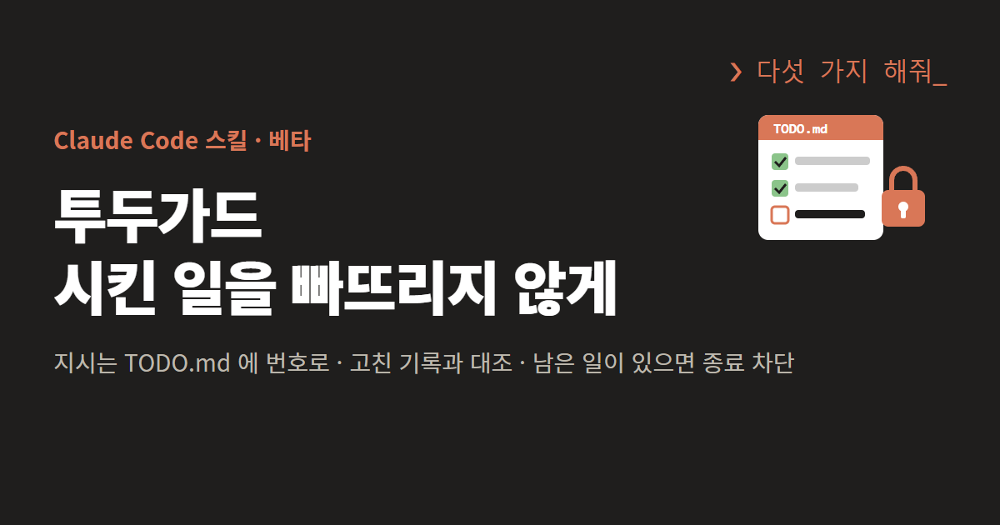

> [!WARNING]
> **베타 판입니다.** 아직 버그가 있고, 쓰다 보면 새 버그가 나옵니다.
> 중요한 저장소에 넣기 전에 연습 폴더에서 먼저 써 보세요. 빼는 방법은 [8. 투두가드 빼기](#8-투두가드-빼기)에 있습니다.

Claude Code 에 일을 여러 개 맡기면 가끔 몇 개가 빠집니다.
「반영하겠습니다」라고 답만 하고 파일은 그대로 두거나, 다섯 개를 시켰는데 두 개만 고치고 답을 끝냅니다.

투두가드는 이런 누락을 훅(Hook)으로 막는 Claude Code 스킬입니다.
메시지를 보내면 훅이 지시를 `TODO.md` 에 번호로 적습니다. 끝나지 않은 번호가 남아 있으면 Claude Code 가 답을 끝내지 못하게 막습니다.
훅은 Claude 가 아니라 Claude Code 가 정해진 순간마다 실행합니다. 그래서 Claude 가 장부를 잊어도 검사는 빠지지 않습니다.

---

## 1. 투두가드가 지시를 챙기는 순서

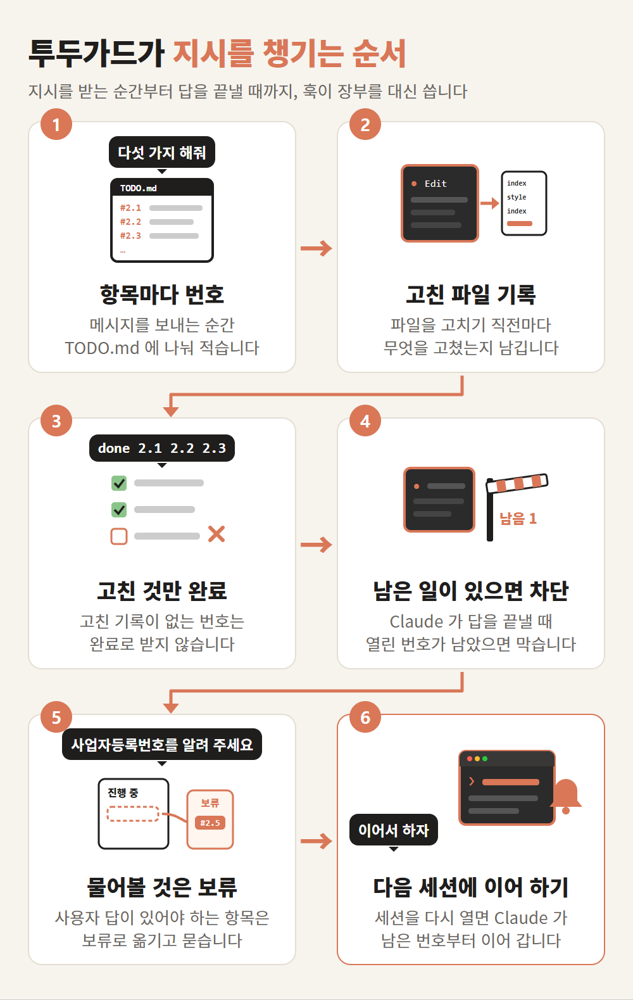

사용자 · Claude Code · 훅 · Claude 가 주고받는 순서로 그리면 아래와 같습니다. 다섯 항목 가운데 넷은 끝내고, 사업자등록번호는 사용자에게 물어야 해서 보류로 옮기는 경우입니다.

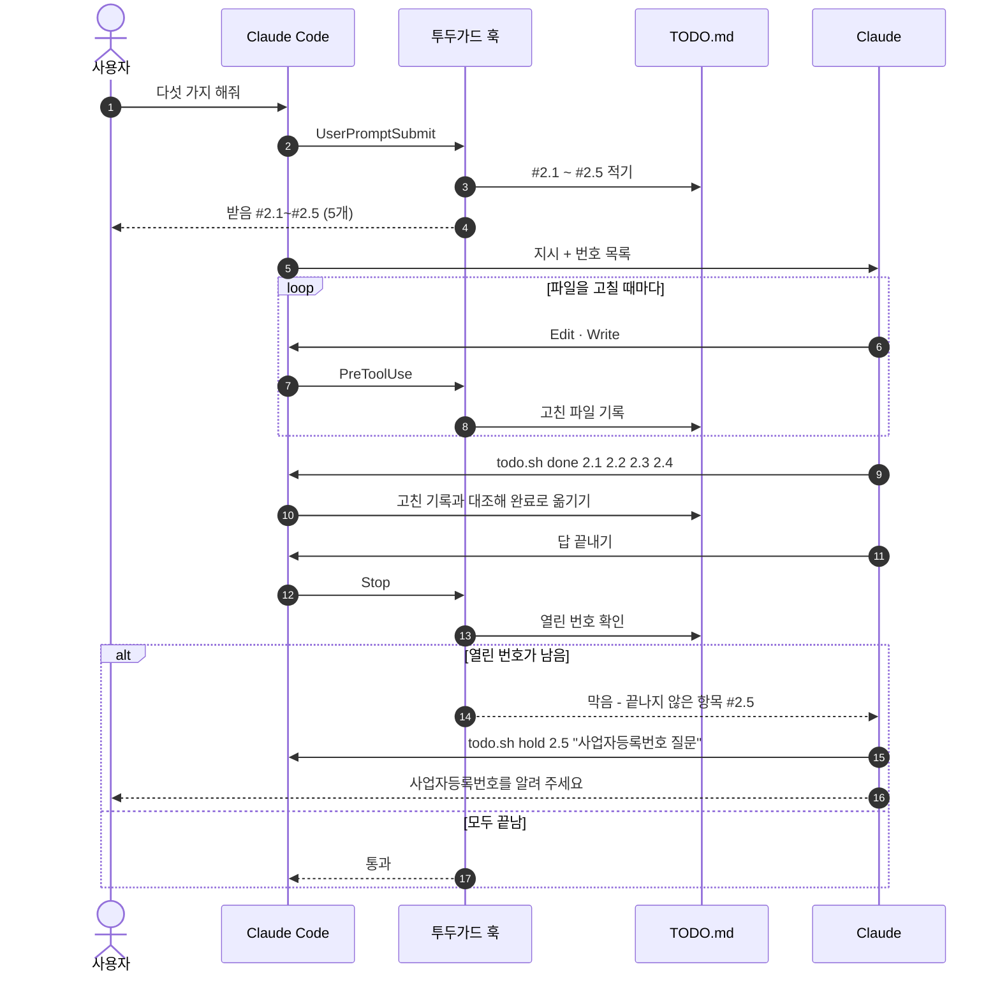

---

## 2. 실제 세션 화면

아래 화면은 연습 폴더(`D:\shop`)에서 Claude Code 를 실제로 실행하고 받아 적은 것입니다. 길게 이어지는 파일 비교(diff)만 「…」로 줄였습니다.

### 한 가지 지시 끝내기

지시를 보내면 훅이 `TODO.md` 에 `#1` 로 적습니다. 한 항목짜리 지시는 화면에 따로 표시하지 않고 Claude 에게만 번호를 넘깁니다.
Claude 는 파일을 고친 뒤 `todo.sh done 1` 로 항목을 닫고 답을 끝냅니다.

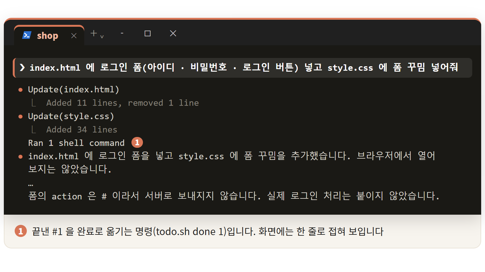

### 다섯 가지를 한 번에 시키기

여러 줄로 시키면 항목마다 번호가 따로 붙습니다. 이때는 받은 개수가 화면에 뜹니다.
다섯째 항목(사업자등록번호)은 Claude 가 값을 몰라서 완료로 처리하지 않고 보류로 옮겼습니다.

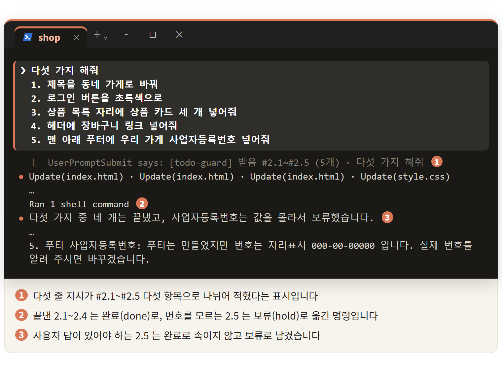

### 작업 중에 보낸 지시 붙잡기

Claude 가 앞 일을 하는 동안 다음 지시를 보내면, 그 지시는 입력창 위에 대기로 쌓입니다.
훅은 이 지시도 받는 순간 장부에 적어 둡니다. 그래서 Claude 가 앞 일만 끝내고 답을 마치려 하면 Stop 훅이 막습니다.

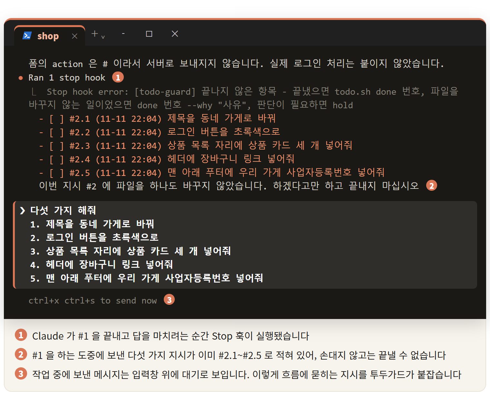

### 「하겠습니다」로 끝내려 할 때 막기

지시를 받고 파일을 하나도 바꾸지 않은 채 답을 끝내려 하면, 「하겠다고만 하고 끝내지 말라」는 말과 함께 되돌려 보냅니다.

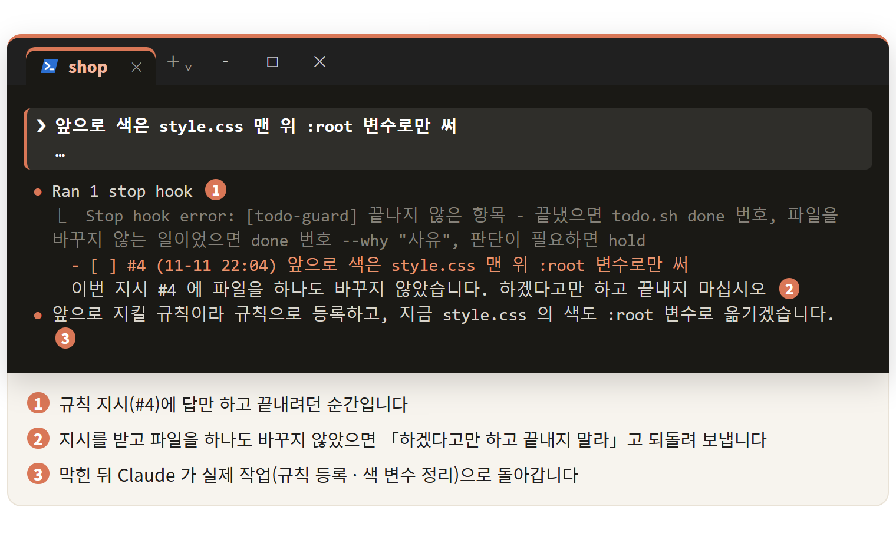

### 다음 세션에서 이어 하기

세션을 닫았다가 다시 열어도 남은 항목은 장부에 그대로 있습니다. 세션을 열 때 SessionStart 훅이 남은 항목을 Claude 에게 넘겨 주므로, 「이어서 하자」 한마디로 남은 일부터 이어 갑니다.

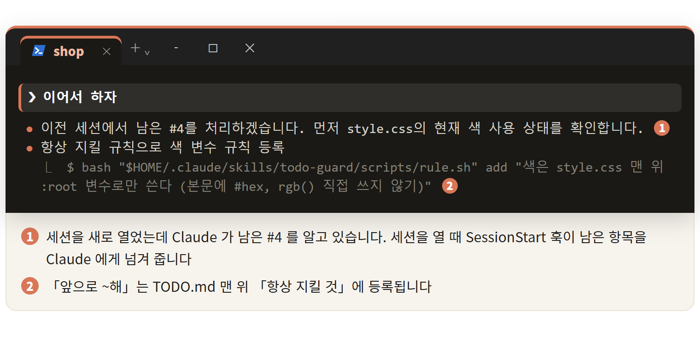

---

## 3. TODO.md 장부 모양

위 세션을 마친 뒤의 `TODO.md` 입니다. 항목마다 번호와 받은 시각이 붙고, 완료 · 보류에는 사유가 남습니다.

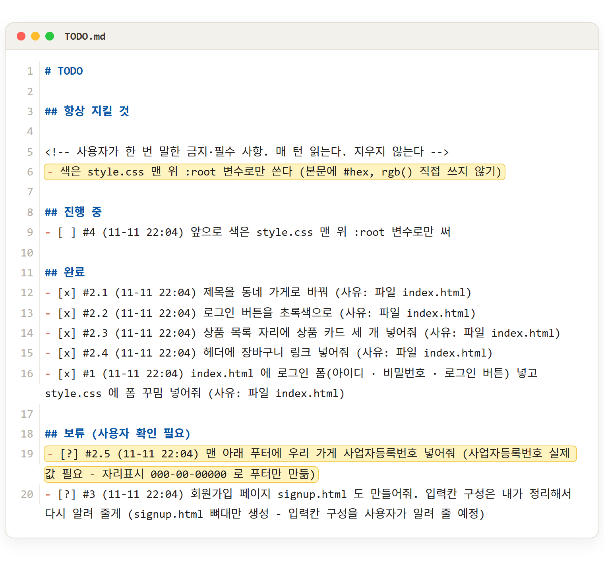

`#2.2` 처럼 실제로는 `style.css` 를 고친 항목에 `index.html` 이 사유로 남기도 합니다.
투두가드는 댄 파일을 그 항목이 적힌 뒤에 고쳤는지만 보고, 그 파일에서 무엇을 고쳤는지는 보지 않습니다. [11. 남은 문제와 한계](#11-남은-문제와-한계)에 적어 둔 한계입니다.

항목은 아래 세 칸을 오갑니다.

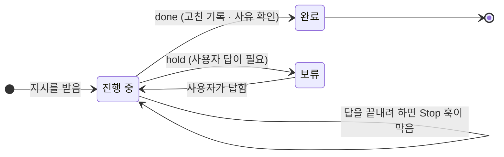

**Claude 는 `TODO.md` 를 직접 열어 고치지 않습니다.** 장부는 훅이 쓰고, Claude 는 끝낸 번호만 확인 명령 뒤에 붙입니다.
도구 호출이 한 번 늘 때마다 대화 전체를 다시 읽으므로 그만큼 비용이 늘기 때문입니다.

```
python -m unittest && todo.sh done 14
```

`&&` 로 이었기 때문에 **앞의 시험이 실패하면 `done` 은 실행되지 않습니다.** 프로젝트에 시험 · 빌드 · 린트가 있으면 그것을 통과해야 항목이 닫힙니다.

---

## 4. 설치와 세팅

### 스킬 설치 (PC 마다 한 번)

[Releases](../../releases) 에서 `todo-guard.zip` 을 받아 `~/.claude/skills/` 에 풉니다. zip 안에 `todo-guard/` 폴더가 들어 있습니다.

```
Windows   C:\Users\<사용자>\.claude\skills\todo-guard\
macOS     ~/.claude/skills/todo-guard/
리눅스     ~/.claude/skills/todo-guard/
```

저장소를 그대로 받아도 됩니다.

```bash
git clone https://github.com/hull-kr/todo-guard.git
cp -r todo-guard/todo-guard ~/.claude/skills/
```

Claude Code 를 다시 열면 스킬 목록에 `todo-guard` 가 보입니다. 자세한 설치 방법은 [INSTALL-ko.md](INSTALL-ko.md) 에 있습니다.

### 프로젝트 세팅 (프로젝트마다 한 번)

프로젝트 폴더에서 Claude Code 를 열고 입력창에 `투두가드 세팅해줘` 를 넣습니다.

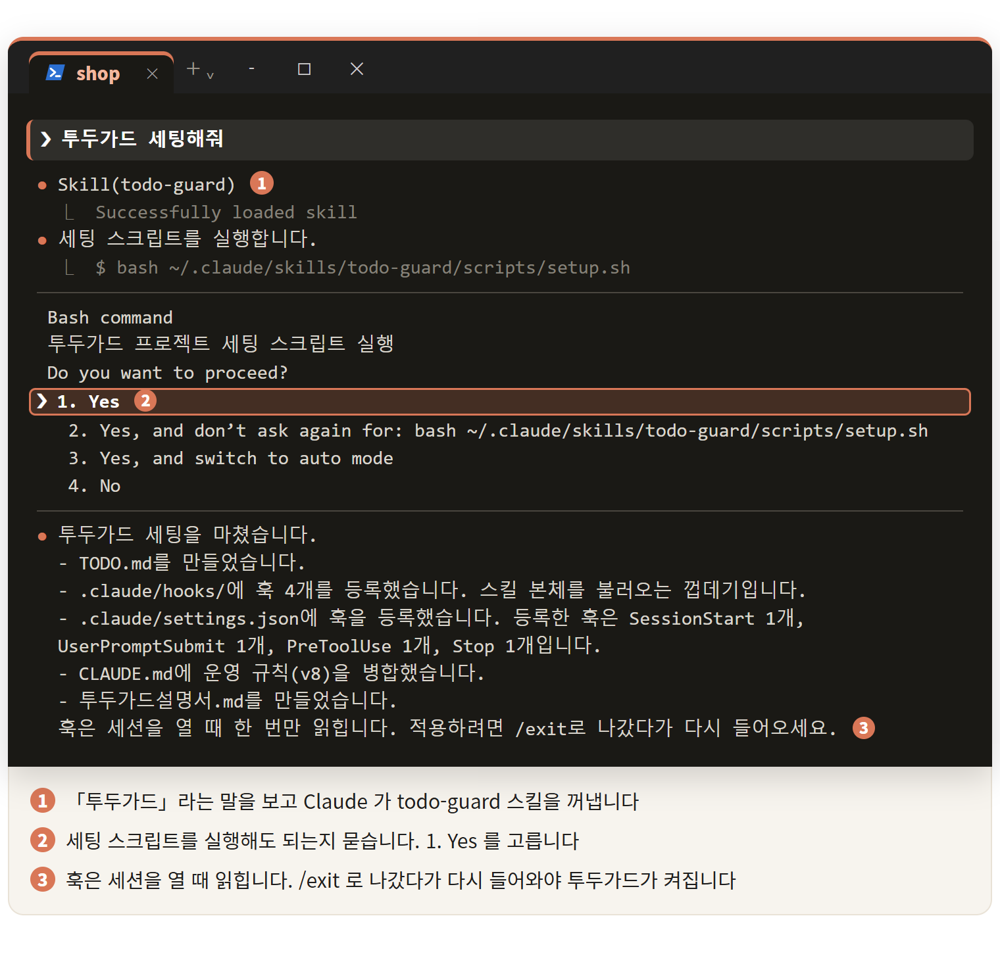

세팅이 끝나면 **`/exit` 로 나갔다가 다시 들어옵니다.** 훅은 세션을 열 때 한 번 읽히기 때문입니다.

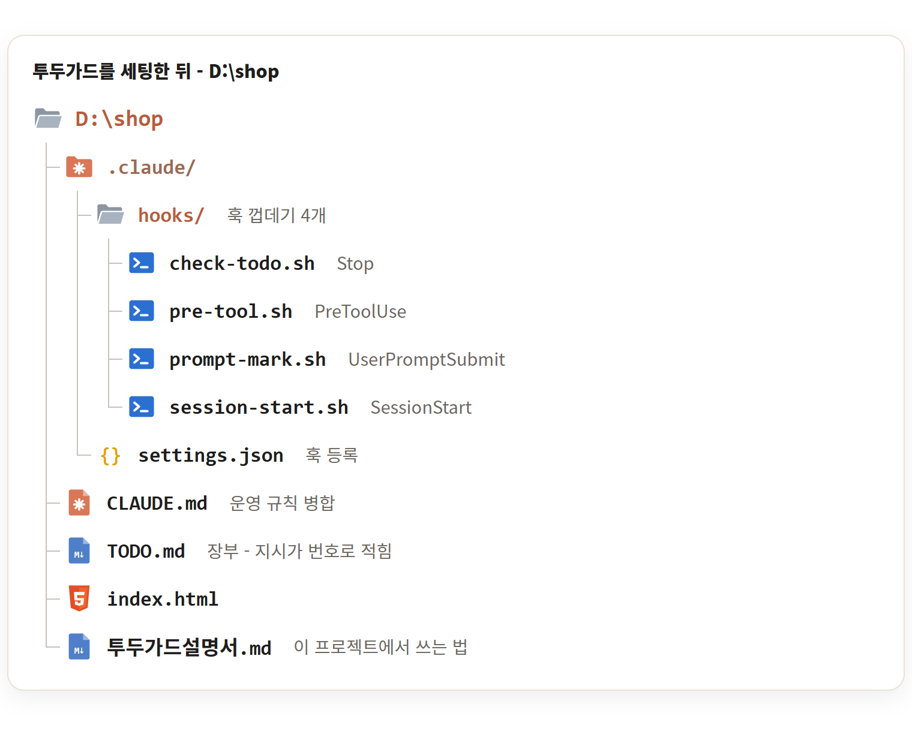

**스킬 설치와 프로젝트 세팅은 다른 일입니다.** 스킬은 PC 에 한 번 깔고, 훅은 프로젝트마다 겁니다.

---

## 5. 훅 4개가 실행되는 때

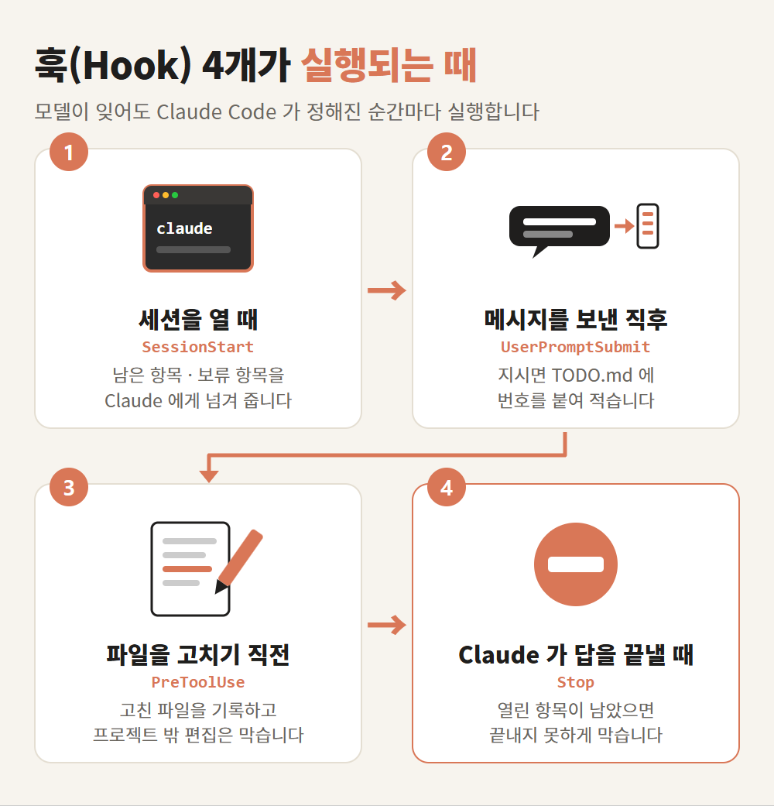

| 훅 | 하는 일 |
|---|---|
| `SessionStart` - 세션을 열 때 | 남은 항목 · 보류 항목을 Claude 에게 전달 (화면에는 뜨지 않음) |
| `UserPromptSubmit` - 메시지를 보낸 직후 | 지시면 `TODO.md` 에 번호를 붙여 기록 |
| `PreToolUse` - 파일을 고치기 직전 | 고친 파일 기록, 프로젝트 밖 편집 차단 |
| `Stop` - Claude 가 답을 끝낼 때 | 열린 항목이 남았으면 종료 차단 |

훅 파일은 프로젝트의 `.claude/hooks/` 에 한 줄짜리 껍데기로 들어가고, 실제 코드는 전역 스킬 폴더에 있습니다.
그래서 스킬만 새 판으로 바꾸면 세팅한 프로젝트 전부에 바로 적용됩니다.

---

## 6. 완료로 받는 기준

「했습니다」라는 말만으로는 닫히지 않습니다. **훅이 남긴 파일 기록과 대조합니다.**

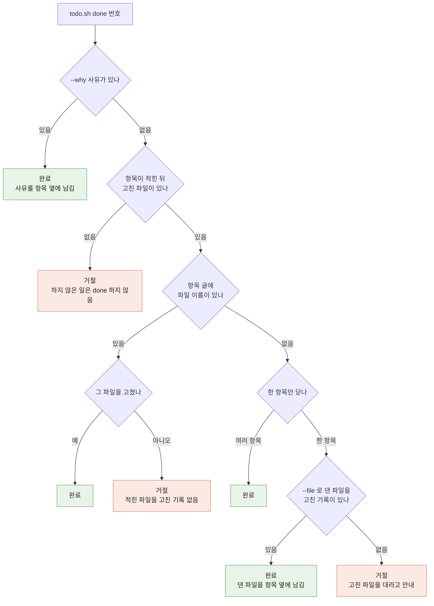

| 항목 글 | 대조하는 것 |
|---|---|
| 파일 이름이 있음 (`login.html 에 폼 넣어줘`) | 그 파일을 항목이 적힌 뒤 고쳤나 |
| 슬라이드 번호가 있음 (`3번 슬라이드 배경`) | 그 번호 파일을 고쳤나 |
| 단서 없음 (`머리글 정리해줘`) | `--file` 로 댄 파일을 고친 기록이 있나 |
| 파일을 고치지 않는 일 (`빌드 돌려봐`) | `--why` 사유. 사유는 장부에 남음 |

**잡지 못하는 것도 있습니다.** 파일을 고치긴 했는데 **잘못 고친 경우**입니다. 투두가드는 파일을 고쳤다는 사실만 보고 내용은 보지 않습니다.
내용 검사는 프로젝트의 시험 · 빌드 · 린트가 맡고, `&& todo.sh done` 으로 이어 두면 됩니다.

---

## 7. Claude 가 쓰는 명령

사람이 외울 명령은 아닙니다. 평소처럼 지시하면 등록 · 완료 · 차단은 훅과 Claude 가 처리합니다.

| 명령 | 하는 일 |
|---|---|
| `todo.sh done 14` | #14 완료. 하위 항목은 끝낸 것만 `done 14.1 14.3` |
| `todo.sh done 14 --file a.tsx` | 항목 글에 파일 이름이 없을 때 고친 파일 제시 |
| `todo.sh done 14 --why "빌드 성공"` | 파일을 고치지 않고 끝난 일(빌드 · 시험 · 조사 · 답변) |
| `todo.sh hold 14 "사유"` | 사용자 판단이 필요해 보류 |
| `todo.sh add "할 일"` | 지시에 없던 일을 직접 추가 |
| `rule.sh add "규칙"` | 「앞으로 ~해」를 「항상 지킬 것」에 등록 |
| `doctor.sh <폴더>` | 세팅한 프로젝트 점검. `--fix` 로 다시 세팅 |

사람이 쓰는 말은 이 세 가지입니다.

```
투두가드 세팅해줘
투두가드 빼줘
앞으로 커밋 전에 시험 돌려        ← 「항상 지킬 것」에 등록
```

---

## 8. 투두가드 빼기

입력창에 `투두가드 빼줘` 를 넣습니다. 지울 것을 먼저 보여 주고, 지우기 전에 `.claude/` 에 백업을 남깁니다.
`TODO.md` 는 기록이라 남겨 둡니다.

---

## 9. 팀에서 같이 쓰기

훅과 설정을 저장소에 커밋해 팀이 같이 쓸 수 있습니다.

- 훅 등록에 **PC 경로를 넣지 않습니다.** `${CLAUDE_PROJECT_DIR:-.}` 로 적어서 사람마다 폴더가 달라도 됩니다.
- **투두가드를 깔지 않은 팀원**에게는 아무 영향이 없습니다. 훅 껍데기가 스킬 본체를 못 찾으면 그냥 넘어갑니다.
- 개인 작업 기록은 `.gitignore` 에 넣습니다.

  ```
  /TODO.md
  /TODO-완료.md
  /.claude/todo-guard/
  /.claude/todo-guard.json
  /.claude/settings.json.bak
  ```

- 모노레포(저장소 하나에 프로젝트 여럿)라면 **하위 프로젝트 폴더에서 세션을 여세요.** 루트에서 열면 하위 폴더의 `settings.json` 을 읽지 않아 훅이 실행되지 않습니다. 오류도 나지 않아 알아채기 어렵습니다.

---

## 10. 필요한 것

- **Claude Code** - 훅을 실행합니다
- **bash** - Windows 는 Claude Code 가 쓰는 Git Bash 를 그대로 씁니다
- **Python 3** - 없으면 `settings.json` 병합과 `doctor` 가 실행되지 않습니다

Windows · macOS · 리눅스에서 씁니다. 시험은 Windows Git Bash 5.3, 리눅스 bash 5.2, bash 4.4 에서 통과했습니다.
macOS 기본 bash 3.2 에 맞춰 짰지만, 3.2 에서 직접 시험하지는 못했습니다.

---

## 11. 남은 문제와 한계

**베타 판입니다.** 지금까지 겪은 것과 아직 고치지 못한 것을 적어 둡니다.

- **목록이 든 긴 글을 붙여 넣으면 줄마다 항목으로 나뉩니다.** 「3번 고치고 5번 넣고」 같은 여러 항목 지시를 나누는 기능이 그 글에도 적용됩니다.
- **잘못 고친 것은 잡지 못합니다.** 파일을 고쳤다는 사실만 봅니다. [6. 완료로 받는 기준](#6-완료로-받는-기준) 참고.
- **같은 파일 하나로 여러 항목을 닫을 수 있습니다.** `--file` 로 댄 파일을 고쳤는지까지만 봅니다.
- **모노레포 루트에서 세션을 열면 훅이 실행되지 않습니다.** 오류가 나지 않아 알아채기 어렵습니다.
- **Windows 에서 Git Bash 자체가 느린 PC 가 있습니다.** 훅이 눈에 띄게 느리면 함께 넣은 `fix-slow-bash.sh` 를 실행해 보세요.
- 훅이 한 턴에 더하는 시간은 0.4초 안팎입니다(Windows 에서 측정).

버그를 만나면 [Issues](../../issues) 에 남겨 주세요. 어떤 지시를 줬고 무엇이 어떻게 됐는지, `TODO.md` 의 해당 줄을 같이 적어 주시면 고치기 쉽습니다.

---

## 시험

```bash
bash todo-guard/tests/shell-parse-test.sh      # 셸 명령 판정 15개
```

---

## 기여

| | |
|---|---|
| 고○○ `<loka@plantynet.com>` | 팀 공용 세팅에서 찾은 버그 네 가지 제보 · 수정 (2026-11-10) - 서브 에이전트 응답이 지시로 등록되던 것, macOS bash 3.2 에서 Stop 훅 JSON 이 깨지던 것, 투두가드를 깔지 않은 팀원에게 훅 오류가 나던 것, 훅 등록에 PC 경로가 들어가던 것 |

고쳐 쓰신 것이 있으면 Pull Request 나 Issue 로 보내 주세요.

---

## 라이선스

아직 정하지 않았습니다. 쓰시는 것은 자유롭게 하시되, 다시 배포하실 일이 있으면 먼저 알려 주세요.
